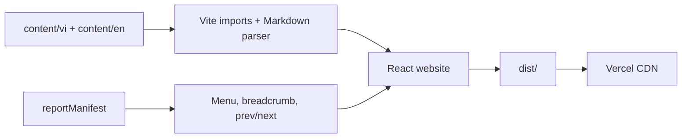

# AWS FCAJ Internship Report

[](https://github.com/trungnguyen-VNTN/aws-fcaj-report/actions/workflows/ci.yml)


Báo cáo thực tập **First Cloud AI Journey** của **Vũ Nguyễn Trung Nguyên**, trình bày
nhật ký học tập, bài viết cộng đồng và workshop triển khai nền tảng thương mại điện tử
dinh dưỡng cá nhân hóa trên AWS. Website hỗ trợ tiếng Việt và tiếng Anh, đọc nội dung
Markdown và được triển khai trên Vercel.

**[Xem báo cáo tiếng Việt](https://aws-fcaj-report.vercel.app/vi)** ·
**[Read in English](https://aws-fcaj-report.vercel.app/en)** ·
**[Mã nguồn ứng dụng](https://github.com/trungnguyen-VNTN/nutrition-ecommerce)**

## Nội dung báo cáo

| Phần | Nội dung | Trạng thái nội dung |
| --- | --- | --- |
| 1. Worklog | 12 tuần, từ 14/09 đến 04/12/2026 | Có lịch học và mốc repo; kết quả cá nhân cần xác nhận |
| 2. Proposal | Phạm vi, kiến trúc, kế hoạch, chi phí và rủi ro | Có nội dung; sơ đồ Draw.io và một số minh chứng còn mở |
| 3. Blogs Posted | SQS/Lambda và DLQ, chi phí NAT Gateway, lỗi ALB 502 | Đủ 3 bài, sơ đồ và liên kết Facebook |
| 4. Events Participated | Khung báo cáo 3 sự kiện | Chờ thông tin tham dự và ảnh check-in |
| 5. Workshop | 7 mục lớn, 13 bước con | Có hướng dẫn từ mã nguồn; chờ ảnh Console và xác minh được đánh dấu |
| 6. Self-Assessment | 12 tiêu chí và hướng cải thiện | Có nhận xét; ô tự chấm điểm để người viết lựa chọn |
| 7. Sharing and Feedback | Đánh giá chương trình và góp ý | Có nội dung song ngữ |

Các khối `:::todo` hiển thị trên website để theo dõi phần cần bổ sung. Bản build thông
thường cho phép xuất bản nội dung đang hoàn thiện. `build:release` kiểm tra nghiêm
ngặt và sẽ thất bại khi còn TODO hoặc trang nháp.

## Tính năng website

- Chuyển ngôn ngữ Việt/Anh, giao diện sáng/tối và bố cục responsive.
- Menu ba cấp có thể mở/thu gọn, breadcrumb và điều hướng trang trước/sau.
- Tìm kiếm nội dung bằng MiniSearch qua `Ctrl/Cmd + K`.
- Markdown với bảng, code có nút sao chép, notice, TODO và ảnh phóng to.
- Kiểm tra cặp trang song ngữ, mục chi phí và các mẫu bí mật phổ biến.

## Cách hoạt động



Nội dung trang nằm trong `content/`. Cây menu khai báo tại
[`src/config/structure.ts`](src/config/structure.ts). Khi thêm một mục mới, cần bổ
sung cả hai ngôn ngữ và cập nhật manifest. Vite nạp lại Markdown trong lúc phát triển.

Kiến trúc ECS/RDS/Bedrock trong workshop thuộc ứng dụng
[`nutrition-ecommerce`](https://github.com/trungnguyen-VNTN/nutrition-ecommerce).
Website báo cáo này được build thành các tệp tĩnh để phục vụ trên Vercel.

## Chạy local

Cài Node.js 22 và npm. CI dùng Node.js 22; dependency được khóa trong `package-lock.json`.

```bash
git clone https://github.com/trungnguyen-VNTN/aws-fcaj-report.git
cd aws-fcaj-report
npm ci
npm run dev
```

Mở `http://localhost:3000`. Có thể chọn cổng khác khi cần:

```bash
npm run dev -- --host 127.0.0.1 --port 5176
```

Trên PowerShell có thể dùng `npm.cmd` thay cho `npm` nếu Execution Policy chặn script.

## Kiểm tra

```bash
npm run check
npm test
npm run build
```

| Lệnh | Mục đích |
| --- | --- |
| `npm run dev` | Chạy Vite development server |
| `npm run check` | Kiểm tra nội dung, cặp ngôn ngữ, mục chi phí và mẫu bí mật |
| `npm run todo:list` | Liệt kê TODO theo tệp và dòng |
| `npm test` | Chạy test Markdown, điều hướng ba cấp và figure |
| `npm run build` | Kiểm tra TypeScript và tạo `dist/` |
| `npm run preview` | Xem bản đã build tại local |
| `npm run build:release` | Kiểm tra bản nộp hoàn chỉnh trước khi build |
| `npm run new:page -- <template> <path>` | Tạo cặp trang Markdown từ template |

Kết quả kiểm tra website ngày **22/11/2026** gồm **7/7 test qua**, content check và
production build thành công. Build hiện có cảnh báo bundle JavaScript lớn hơn 500 kB.

## Cấu trúc repository

```text
content/vi/              Nội dung báo cáo tiếng Việt
content/en/              Nội dung báo cáo tiếng Anh
content-templates/      Mẫu để tạo trang mới
public/images/          Sơ đồ và ảnh được dùng trong báo cáo
src/config/             Thông tin website và cây mục lục
src/components/         Layout, Markdown và các thành phần báo cáo
src/pages/              Trang chủ và trang tài liệu
src/services/           Nạp nội dung, TOC và chỉ mục tìm kiếm
src/test/               Vitest và Testing Library
scripts/                Kiểm tra nội dung và tạo trang
docs/                  Hướng dẫn biên tập và triển khai
.github/                CI, mẫu issue và pull request
vercel.json             Vite build và rewrite cho SPA
```

## Triển khai

**[Mở website trên Vercel](https://aws-fcaj-report.vercel.app)** ·
[Tiếng Việt](https://aws-fcaj-report.vercel.app/vi) ·
[English](https://aws-fcaj-report.vercel.app/en)

[GitHub Actions](.github/workflows/ci.yml) chạy kiểm tra trên push và pull request.
Project Vercel được liên kết với repo này để triển khai nhánh `main`. Cấu hình
[`vercel.json`](vercel.json) đặt đường dẫn asset về `/` và rewrite các route tài liệu
về `index.html` để hỗ trợ mở trực tiếp trang con.

Xem [hướng dẫn triển khai](docs/DEPLOYMENT.md) để kiểm tra deployment hoặc phát hành
bằng Vercel CLI.

## Tài liệu và đóng góp

- [Thêm hoặc chỉnh sửa nội dung](docs/HOW_TO_ADD_CONTENT.md)
- [Triển khai và xác minh production](docs/DEPLOYMENT.md)
- [Quy trình đóng góp](CONTRIBUTING.md)
- [Báo lỗi](https://github.com/trungnguyen-VNTN/aws-fcaj-report/issues/new?template=bug_report.yml)
- [Đề nghị sửa nội dung](https://github.com/trungnguyen-VNTN/aws-fcaj-report/issues/new?template=content_update.yml)

## English

This repository hosts a bilingual FCAJ internship report with a 12-week worklog,
project proposal, three published articles, event outlines, a grouped AWS workshop,
self-assessment, and feedback. React renders Markdown content through Vite; the
navigation tree is maintained in `src/config/structure.ts`.

Use `npm ci` and `npm run dev` to start locally. Run `npm run check`, `npm test`, and
`npm run build` before submitting changes. Drafts and TODOs remain visible while the
report is being completed. The production website is hosted on Vercel.
